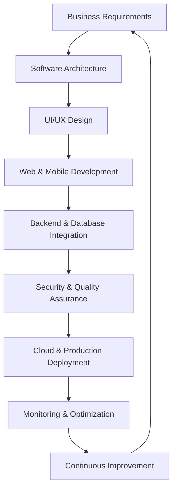

 

---

## 👨‍💻 About Me

I'm a **Software Engineer and Full-Stack & Mobile Developer** passionate about building innovative, scalable and reliable digital solutions.

I develop complete software ecosystems across web, mobile and cloud platforms, combining modern frontend technologies, robust backend architectures, enterprise systems and business automation.

My experience covers the entire software development lifecycle — from planning and architecture to development, testing, deployment and continuous optimization.

- 🇵🇹 Portuguese developer based in Germany.
- 🌐 Full-stack web development.
- 📱 Android and iOS application development.
- 🏢 Enterprise software and business management systems.
- ⚙️ Backend engineering and API development.
- ☁️ Cloud infrastructure and server administration.
- 🤖 Artificial intelligence integration and automation.
- 🎮 Multiplayer game development and digital ecosystems.
- 🔐 Authentication, security and access management.

> Technology is not just about writing code. It's about building solutions that make a difference.

---

## 🚀 Projects & Professional Experience

### 🟣 UtopiaRP — Gaming & Digital Ecosystem

**Lead Developer**

A Portuguese FiveM roleplay community supported by a custom-developed digital ecosystem connecting multiplayer game servers, web applications, databases and management platforms.

- Custom gameplay systems and multiplayer resources.
- Player dashboards and administrative platforms.
- Account management and authentication.
- Economy, banking and financial systems.
- Inventory and organization management.
- Real-time game and web integrations.
- Server infrastructure and performance optimization.
- Automated workflows and operational tools.

---

### 🔵 TecPrime — Digital Solutions & IT Services

**Software Development · Mobile Applications · IT Solutions**

Technology solutions designed to address real business requirements across different industries.

- Professional websites and web applications.
- Android and iOS mobile applications.
- Custom enterprise software.
- Business management platforms.
- Technical support and helpdesk solutions.
- API development and system integrations.
- Business process automation.
- Cloud deployment and ongoing maintenance.

---

### 🏢 Enterprise Software & Business Digitalization

Development of integrated digital solutions designed to modernize business operations, improve productivity and simplify communication.

| Solution | Functionality |
| :--- | :--- |
| Mobile Applications | Android and iOS applications |
| Customer Portals | Secure customer access and communication |
| Ticketing Systems | Requests, incidents and issue management |
| Workforce Management | Employee and operational management |
| Time Tracking | Digital attendance and working hours |
| Management Dashboards | Centralized business information |
| Push Notifications | Real-time alerts and communication |
| Access Control | Role-based permissions and authentication |
| Cloud Platforms | Centralized data and synchronization |
| Business Automation | Digital workflows and process optimization |

Connecting mobile applications, web platforms and backend services into unified digital ecosystems.

---

## 💻 Technology Stack

### 📱 Mobile Application Development

### 🎨 Frontend Development

### ⚙️ Backend Development

### 🗄️ Databases & Backend Services

### ☁️ Cloud, Infrastructure & DevOps

### 🔐 Security & Authentication

### 🎮 Game Development

### 🤖 Artificial Intelligence & Development Tools

---

## 🧩 Core Expertise

| Software Development | Engineering & Infrastructure |
| :--- | :--- |
| Full-Stack Web Development | Software Architecture |
| Android & iOS Development | Cloud Infrastructure |
| Cross-Platform Applications | Server Administration |
| Enterprise Software | Database Architecture |
| REST API Development | Application Security |
| UI/UX & Responsive Design | Performance Optimization |
| Business Management Systems | System Integrations |
| Multiplayer Game Development | Deployment & Maintenance |
| AI Integration | Business Process Automation |
| Real-Time Applications | Data Management |

---

## 🏗️ Software Development Lifecycle

Every project is approached as a complete software ecosystem, designed with scalability, security, maintainability and long-term business value in mind.

---

## 🌐 Platforms & Solutions

| 🌍 Web | 📱 Mobile | 🏢 Enterprise | 🎮 Gaming |
| :---: | :---: | :---: | :---: |
| Websites | Android Apps | Management Systems | FiveM Resources |
| Web Applications | iOS Apps | Customer Portals | Multiplayer Systems |
| Dashboards | Cross-Platform Apps | Ticketing Platforms | Economy Systems |
| APIs | Push Notifications | Workforce Solutions | Game Integrations |

---

## 🧠 Engineering Philosophy

- **Performance** — Build fast, efficient and responsive applications.
- **Scalability** — Design systems capable of supporting future growth.
- **Security** — Protect users, data and infrastructure.
- **Maintainability** — Write clean, structured and sustainable code.
- **Innovation** — Explore emerging technologies and better approaches.
- **User Experience** — Make complex systems intuitive and accessible.
- **Business Value** — Build technology that solves real problems.

---

## 🎯 Current Focus

- Native and cross-platform mobile applications.
- Enterprise software and digital transformation.
- AI-powered applications and intelligent automation.
- Scalable full-stack platforms.
- Cloud infrastructure and system architecture.
- Real-time business management solutions.
- Gaming technologies and multiplayer ecosystems.
- Continuous software optimization and innovation.

---

## 🌍 Languages

---

## 🤝 Let's Connect

Open to collaborations, professional opportunities, technology partnerships and innovative software projects.

 

  

### Engineering solutions. Connecting platforms. Building the future.

**Always building. Always evolving.**

